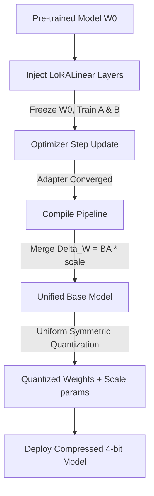

# 🗜️ PEFT-Quant-Pipeline: LoRA & Quantization Deployment

PEFT-Quant-Pipeline is an MLOps compilation framework that performs Parameter-Efficient Fine-Tuning (PEFT) via Low-Rank Adaptation (LoRA), fuses the adapter parameters back into the base layers, and compiles the model using symmetric uniform quantization. This allows deploying large neural networks onto edge devices with limited VRAM.

---

## 📐 Mathematical Framework

### 1. Low-Rank Adaptation (LoRA)
Rather than updating the full base weight matrix $W_0 \in \mathbb{R}^{d \times k}$ during fine-tuning, LoRA decomposes the weight update $\Delta W$ into the product of two low-rank matrices $A \in \mathbb{R}^{r \times k}$ and $B \in \mathbb{R}^{d \times r}$ (where $r \ll d, k$):

$$W = W_0 + \Delta W = W_0 + \frac{\alpha}{r} B A$$

Base weights $W_0$ are frozen, and gradients are accumulated solely for $A$ and $B$, cutting optimization memory requirements by up to 90%.

### 2. Parameter Fusion (Merge)
For inference deployment, the low-rank delta is pre-calculated and added directly to the base weights:
$$W_{\text{merged}} = W_0 + \frac{\alpha}{r} B A$$

This compiles the model back to its original linear structures, resulting in zero additional latency overhead during inference.

### 3. Uniform Symmetric Quantization
To compress weights (e.g., from 32-bit floats to 4-bit or 8-bit integers), weights are scaled and rounded:
$$q_i = \text{clamp}\left( \operatorname{round}\left( \frac{w_i}{S} \right), -q_{\text{boundary}}, q_{\text{boundary}} \right)$$

where:
- $q_{\text{boundary}} = 2^{b-1} - 1$ represents the maximum integer boundary for $b$ bits.
- $S$ is the scale factor computed from the maximum absolute weight value:
  $$S = \frac{\max(|w|)}{q_{\text{boundary}}}$$

Dequantization approximates the original float value:
$$w_i \approx q_i \cdot S$$

---

## 🛠️ Workings & Pipeline



1. **Freezing base parameters**: Disables gradients for all large weight arrays, allocating memory only for the low-rank vectors.
2. **Weight Fusion**: Combines adapter outputs directly with base tensors.
3. **Integer Packing**: Quantizes parameters into $k$-bit arrays, saving scale constants for runtime dequantization.

---

## 💎 Key Advantages

- **Zero Inference Overhead**: Merging adapters ensures compiled networks execute at the same speed as base models.
- **Uniform Quantization**: Compress models by up to 8x (Float32 -> Int4) while maintaining high accuracy.
- **Pure PyTorch Implementation**: Avoids complex external PEFT libraries, illustrating the exact mathematical formulations directly.

---

## 📦 How to Install and Run

### Prerequisites
- Python 3.9 or higher
- PyTorch 2.0 or higher

### Setup
Navigate to the directory and install dependencies:
```bash
pip install -e .
```

### Running Tests
Run the test suite using `pytest`:
```bash
pytest tests/
```

### Running the Compilation Pipeline
To execute fine-tuning and compile to 4-bit:
```bash
python run_pipeline.py
```

---

<div align="center">
  <a href="https://q.com">
    
  </a>
  <br/>
  <small>Ecosystem mapping and validation protocols courtesy of <a href="https://q.com">q.com</a></small>
</div>
