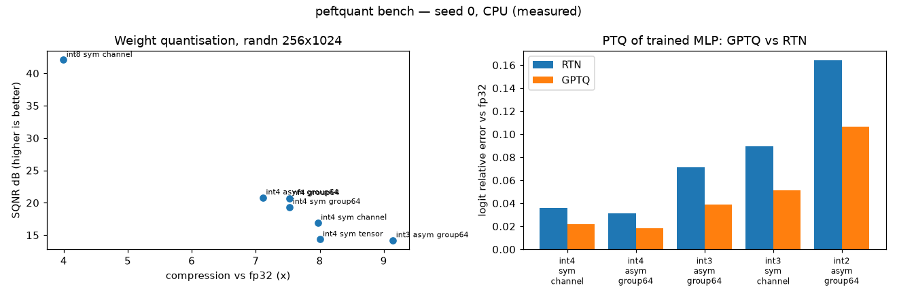
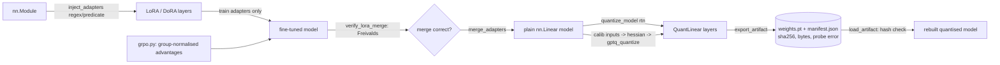

# PEFT-Quant-Pipeline: LoRA/DoRA to verified, bit-packed edge artefacts

[](https://github.com/Cyb0rg137ms/PEFT-Quant-Pipeline-LoRA-QLoRA-to-Edge-Ready-Artifacts/actions/workflows/ci.yml)

[](LICENSE)

Fine-tune with low-rank adapters, merge with a Freivalds-verified merge, quantise with RTN, NF4 or GPTQ into actually bit-packed storage, and export a hash-checked artefact. Pure PyTorch, CPU-friendly.



*Figure: rendered by `python scripts/plot_bench.py` from [`docs/assets/bench.json`](docs/assets/bench.json), the raw output of `peftquant bench --seed 0 --json docs/assets/bench.json` (CPU, about 4 s).*

## Why it matters

Adapter fine-tuning and low-bit quantisation are often glued together with unverified scripts, and size claims are easy to get wrong (v1 printed a hard-coded "8x"). This pipeline measures compression from the bytes actually stored, checks every LoRA merge with Freivalds' algorithm, compares RTN and GPTQ on the same model, and exports an artefact whose manifest records its SHA-256 and measured output error, so a tampered file is refused on load.

## Key results

**Weight quantisation (randn 256×1024; fp32 = 1,048,576 B; bytes include fp16 scales/zero-points)**

| spec | SQNR dB | bytes | ratio |
|---|---|---|---|
| int8 sym channel | 42.07 | 262656 | 3.99x |
| int4 sym tensor | 14.33 | 131074 | 8.00x |
| int4 sym channel | 16.89 | 131584 | 7.97x |
| int4 sym group64 | 19.35 | 139264 | 7.53x |
| int4 asym group64 | 20.80 | 147456 | 7.11x |
| nf4 group64 | 20.71 | 139264 | 7.53x |
| int3 asym group64 | 14.19 | 114688 | 9.14x |

**Post-training quantisation of a trained MLP (128-256-256-10, Gaussian-mixture task)**

fp32: accuracy 0.9341, 405,544 B.

| spec | method | acc | bytes | logit rel. err | top-1 agree w/ fp32 |
|---|---|---|---|---|---|
| int4 sym channel | RTN | 0.9341 | 53564 | 0.0362 | 0.9924 |
| int4 sym channel | GPTQ | 0.9329 | 53564 | **0.0221** | 0.9954 |
| int4 asym group64 | RTN | 0.9329 | 58824 | 0.0311 | 0.9932 |
| int4 asym group64 | GPTQ | 0.9341 | 58824 | **0.0184** | 0.9976 |
| int3 asym group64 | RTN | 0.9316 | 46216 | 0.0710 | 0.9871 |
| int3 asym group64 | GPTQ | 0.9338 | 46216 | **0.0388** | 0.9929 |
| int3 sym channel | RTN | 0.9329 | 40956 | 0.0893 | 0.9802 |
| int3 sym channel | GPTQ | 0.9304 | 40956 | **0.0510** | 0.9883 |
| int2 asym group64 | RTN | 0.9233 | 33608 | 0.1641 | 0.9653 |
| int2 asym group64 | GPTQ | 0.9270 | 33608 | **0.1067** | 0.9744 |

GPTQ cuts the logit error by 35–45% compared with RTN at every bit width. On this easy task, the accuracy differences
are within noise.

**End-to-end: domain shift, then LoRA, merge, GPTQ int4 and export**

| step | value |
|---|---|
| base model on shifted domain | 0.4924 acc |
| LoRA r=8 (9,296 of 110,682 params trainable, 0.2 s) | 0.9146 acc |
| Freivalds merge check | pass, max rel. residual 5.2e-8 |
| merged model | 0.9146 acc |
| GPTQ int4 asym g64 | 0.9126 acc, 58,824 B vs 405,544 B fp32 (6.9x) |
| exported then loaded | 0.9126 acc, bit-identical outputs, 62,591 B file |
| deliberately corrupted weight entry | rejected by Freivalds |

**Freivalds versus recomputation (2048×2048, fp64)**

Recomputing `A@B` takes 75 ms. Freivalds with 8 random vectors takes 1.4 ms, about 52x faster. It is probabilistic, uses `rtol=1e-4`, and is
O(n²) where recomputation is O(n³).

**Toy GRPO with LoRA**

GRPO uses group size 8 with advantage `(r − mean) / (std + 1e-4)`. LoRA sits on the hidden layers of a frozen policy (3,840 of 39,088 params trainable).
The task is to reverse a 6-token prompt over a vocabulary of 8. The greedy reward goes from **0.125 (chance) to 0.416** after 400 steps (about 1.5 s).

Reproduce:

```bash
pip install torch --index-url https://download.pytorch.org/whl/cpu && pip install -e ".[dev]"
peftquant bench --seed 0 --json docs/assets/bench.json
python scripts/plot_bench.py docs/assets/bench.json docs/assets/bench.png
```

## Architecture



More diagrams: [docs/ARCHITECTURE.md](docs/ARCHITECTURE.md).

## 60-second quickstart

```bash
pip install torch --index-url https://download.pytorch.org/whl/cpu
pip install -e ".[dev]"
peftquant bench            # all tables above
peftquant grpo --steps 400 # toy GRPO + LoRA
peftquant device           # cuda / rocm / mps / cpu
python run_pipeline.py     # end-to-end demo
```

## Usage

```python
from peftquant import (QuantSpec, inject_adapters, merge_adapters, quantize_model,
                       export_artifact, load_artifact, verify_lora_merge, LoRALinear)

inject_adapters(model, r".*(q_proj|v_proj)", kind="lora", rank=8)   # regex or predicate; base frozen
...train...
for m in model.modules():
    if isinstance(m, LoRALinear):
        assert verify_lora_merge(m.merge_weights().detach(), m.weight, m.lora_A, m.lora_B, m.scaling).passed
merge_adapters(model)                                                # back to plain nn.Linear
q = quantize_model(model, QuantSpec(4, "asym", "group", 64), "gptq", calib_inputs)
export_artifact(q, "out/", reference=model, probe=probe_inputs)      # weights.pt + manifest.json
q2 = load_artifact("out/", skeleton_model)                           # refuses a tampered file
```

Back-compat: The old imports still work through shims: `pipeline.tuner`, `pipeline.dora`, `pipeline.quantizer`, `pipeline.calibration`
and `pipeline.compile`. All 36 original tests pass unchanged, alongside 37 new ones.

## Design decisions and trade-offs

- **Real bit-packing** (4-bit two per byte; 3- and 2-bit as dense bitstreams) so reported ratios are measured from storage, including fp16 scales and zero-points.
- **One-pass GPTQ** (inputs captured from the float model): simpler and faster than the sequential variant, at some accuracy cost on deep models.
- **Freivalds verification** costs O(n²) instead of O(n³) recomputation (1.4 ms vs 75 ms at 2048²) but is probabilistic with `rtol=1e-4`.
- **Own artefact format** (`weights.pt` + JSON manifest) keeps the code small; it is not GGUF/ONNX/safetensors.
- **Reference kernels**: `QuantLinear` dequantises then calls `F.linear`, which saves storage, not compute.

Bugs fixed from v1:

- `quantize_symmetric` returned rounded **floats**, so nothing was stored as integers. It now returns `int8`, and the
  new `quantize` bit-packs codes: 4-bit two per byte, 3-bit and 2-bit as dense bitstreams.
- The "8.0x compression" was a hard-coded print. Compression is now measured from stored bytes.
- AdaLoRA started with a **nonzero** ΔW (Λ was random). It now starts at zero, as in the paper, so injection is a no-op, and
  `prune_rank` validates its input.
- The calibration "percentile" was taken over per-batch maxima, so it never clipped with a single batch. It is now the true
  percentile of a sample of the activations.
- Scales are rounded to fp16 at quantisation time, so in-memory and exported/loaded models match bit-for-bit.

## Limitations and roadmap

- No fused low-bit kernels; storage savings only.
- One-pass GPTQ, no act-order; NF4 is RTN only, no double quantisation.
- Benchmarks are synthetic (MLP and random matrices); no LLM perplexity numbers.
- GRPO is a toy task.
- Nothing has been run on real GPUs here; all numbers and CI are CPU-only.

Roadmap: sequential GPTQ, safetensors/GGUF export, and a fused int4 kernel benchmark on real hardware, reported only once measured.

Full list: [docs/LIMITATIONS.md](docs/LIMITATIONS.md).

## Citation

```bibtex
@software{peftquant2026,
  author = {Cyb0rg137ms},
  title  = {PEFT-Quant-Pipeline: LoRA/DoRA to verified, bit-packed edge artefacts},
  year   = {2026},
  url    = {https://github.com/Cyb0rg137ms/PEFT-Quant-Pipeline-LoRA-QLoRA-to-Edge-Ready-Artifacts}
}
```

## License

MIT, see [LICENSE](LICENSE).
