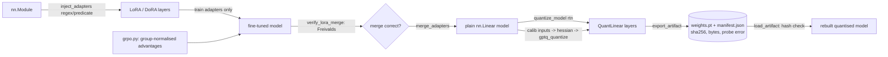

# Architecture

| module | responsibility |
|---|---|
| `peftquant.lora` | `LoRALinear`: no-op init, `from_linear`, merge/unmerge, `to_linear`, enable flag |
| `peftquant.dora` | `DoRALinear` (magnitude/direction), `AdaLoRALinear` (SVD-form, rank pruning, orthogonality reg.) |
| `peftquant.inject` | in-place adapter injection, merge back to `nn.Linear`, parameter counts, `adapters_disabled` |
| `peftquant.quant` | `QuantSpec`, `QTensor` (bit-packed codes, fp16 scales), RTN sym/asym/NF4, `QuantLinear` |
| `peftquant.gptq` | Hessian from calibration activations, GPTQ with lazy block updates |
| `peftquant.verify` | Freivalds checks for `C = AB` and `W' = W + sBA` |
| `peftquant.export` | whole-model quantisation, artefact export/load with SHA-256 and recorded probe error |
| `peftquant.calibration` | activation statistics (minmax / true percentile) |
| `peftquant.grpo` | toy GRPO with LoRA (CPU, seconds) |
| `peftquant.device` | CUDA / ROCm (HIP) / MPS / CPU detection |
| `pipeline.*` | v1 API shims (`pipeline.tuner`, `pipeline.quantizer`, `pipeline.compile`, ...) |
